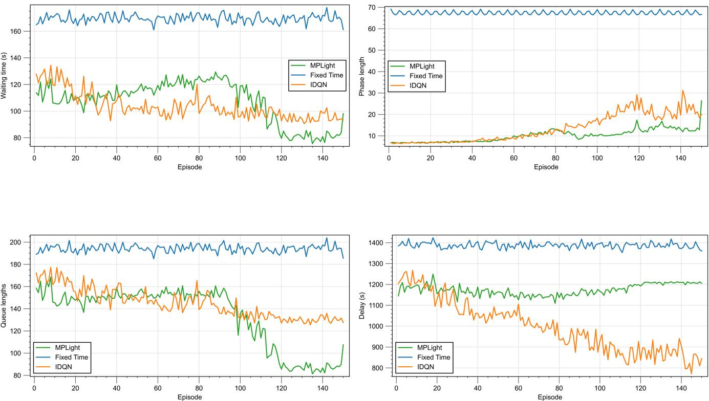

# Reinforcement-Learning Traffic Signal Control under Heterogeneous Traffic: Tigerpass, Chattogram

Can deep reinforcement learning control a real intersection where **rickshaws, CNG auto-rickshaws, human haulers, motorcycles, buses and cars** share the road? This repository applies two state-of-the-art RL signal controllers, **IDQN** and **MPLight**, to the Tigerpass intersection in Chattogram, Bangladesh, and compares them with the existing fixed-time plan in SUMO.

The experiments are built on the [RESCO benchmark](https://datasets-benchmarks-proceedings.neurips.cc/paper/2021/hash/f0935e4cd5920aa6c7c996a5ee53a70f-Abstract-round1.html) (Ault & Sharon, NeurIPS 2021). This repository adds the Tigerpass scenario, its signal definition and the experiment configuration.

<p align="center"></p>

## Key results

After training (last ~10 of 150 episodes), compared with the fixed-time plan. Values are read from the learning curves below.

| Controller | Waiting time | Queue length | Delay (time loss) |
|---|---|---|---|
| Fixed time | ~168 s | ~193 | ~1,385 s |
| **MPLight** | ~82 s (**−51%**) | ~88 (**−54%**) | ~1,205 s (−13%) |
| **IDQN** | ~94 s (−44%) | ~129 (−33%) | ~840 s (**−39%**) |

- **Both RL controllers clearly beat the fixed-time plan** on every measure.
- **There is a trade-off between the two:** MPLight, which optimizes pressure, gives the shortest queues and waiting times, while IDQN, which optimizes waiting time per step, gives the largest reduction in total delay.
- **RL uses much shorter phases.** The fixed plan runs ~67 s phases, while the learned controllers settle on 10–25 s, adapting quickly to the mixed traffic.

<p align="center"></p>

## Scenario

| | |
|---|---|
| Location | Tigerpass intersection, Chattogram, Bangladesh |
| Layout | 4-leg signalized intersection, one signal (`t`), 4 phases |
| Demand | 10 turning movements, 226–585 veh/h each |
| Vehicle mix | car 26%, CNG 22%, motorcycle 16%, bus 11%, human hauler 7%, rickshaw 6%, truck 5%, tempo 4%, bicycle 3% |
| Fixed-time plan | green 33 s / 6 s per direction pair with 2 s transitions |

The scenario is also available as a standalone, pip-installable package for [sumo-rl](https://github.com/LucasAlegre/sumo-rl) users: **[mixed-traffic-sumo](https://github.com/syeda-tamzida/mixed-traffic-sumo)**.

## Controllers

| | State | Reward | Network |
|---|---|---|---|
| **Fixed time** | – | – | original signal plan |
| **IDQN** | DRQ lane features | negative waiting time | DQN, 3 layers × 64 units |
| **MPLight** | phase pressure | negative pressure | FRAP-based DQN |

Both learning agents use a learning rate of 1e-3, batch size 32, discount 0.99, a replay buffer of 20,000, target updates every 500 steps and ε decaying from 1.0 to 0 over 80% of training. Full settings are in [`src/config/agent.yaml`](src/config/agent.yaml).

## Repository structure

```
src/environments/tigerpass/   SUMO network, routes and configuration for Tigerpass
src/config/signal.yaml        Tigerpass signal phases, lane sets and fixed-time plan
src/config/agent.yaml         IDQN, MPLight and fixed-time settings
src/config/config.yaml        Experiment settings (episodes, step length, yellow time…)
src/agents, src/mdp_options   RESCO agents, states and rewards used in the experiments
figures/                      Network figure and learning curves
```

## Running the experiments

This code runs inside a RESCO installation; files such as `resco_benchmark/utils` come from RESCO itself.

1. Install [SUMO](https://sumo.dlr.de/docs/Installing/index.html) and set `SUMO_HOME`.
2. Install the RESCO benchmark and its requirements (PyTorch, PFRL, quik-config).
3. Copy `src/environments/tigerpass/` into RESCO's `environments/` folder, and merge the `tigerpass` entries from `src/config/signal.yaml` and `pretty_names.yaml` into RESCO's config files.
4. Run each controller from RESCO's `resco_benchmark` folder:

```bash
python main.py @tigerpass @FIXED
python main.py @tigerpass @IDQN
python main.py @tigerpass @MPLight
```

Add `libsumo:False` on systems where libsumo is unavailable, or `gui:True` to watch the simulation.

## Citation

```bibtex
@misc{akter2026tigerpassrl,
  title  = {Traffic Signal Control Optimization for Heterogeneous Traffic Using Reinforcement Learning},
  author = {Akter, Syeda Tamzida and others},
  year   = {2026},
  note   = {Under review}
}
```

Please also cite RESCO, on which these experiments are built:

```bibtex
@inproceedings{ault2021reinforcement,
  title     = {Reinforcement Learning Benchmarks for Traffic Signal Control},
  author    = {Ault, James and Sharon, Guni},
  booktitle = {Proceedings of the 35th Conference on Neural Information Processing Systems (NeurIPS 2021) Track on Datasets and Benchmarks},
  year      = {2021}
}
```

## License

The Tigerpass scenario, configuration and figures are released under the MIT License (see `LICENSE`). Files adapted from RESCO remain subject to RESCO's original license.
