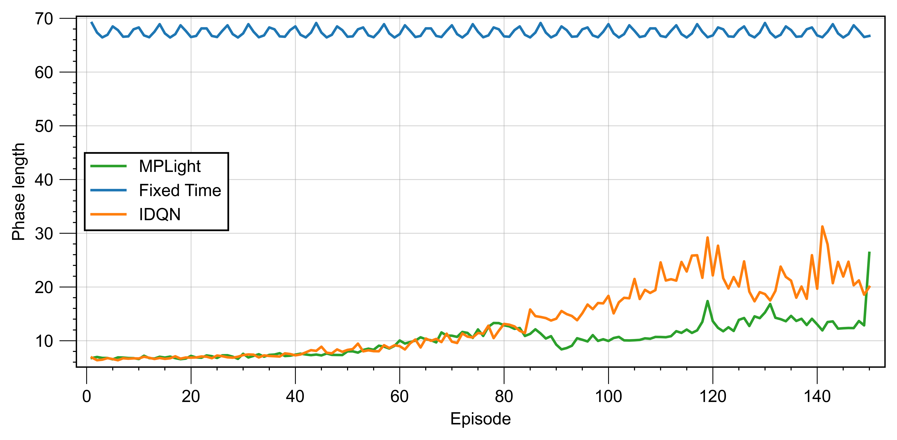
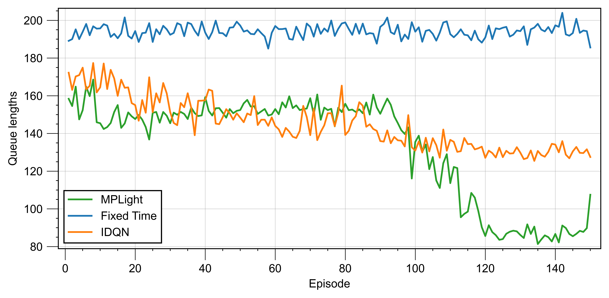
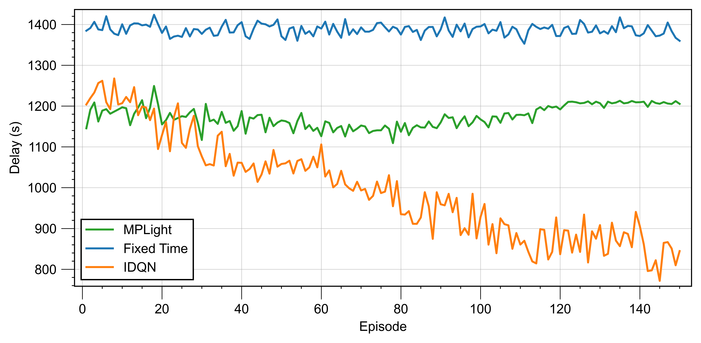
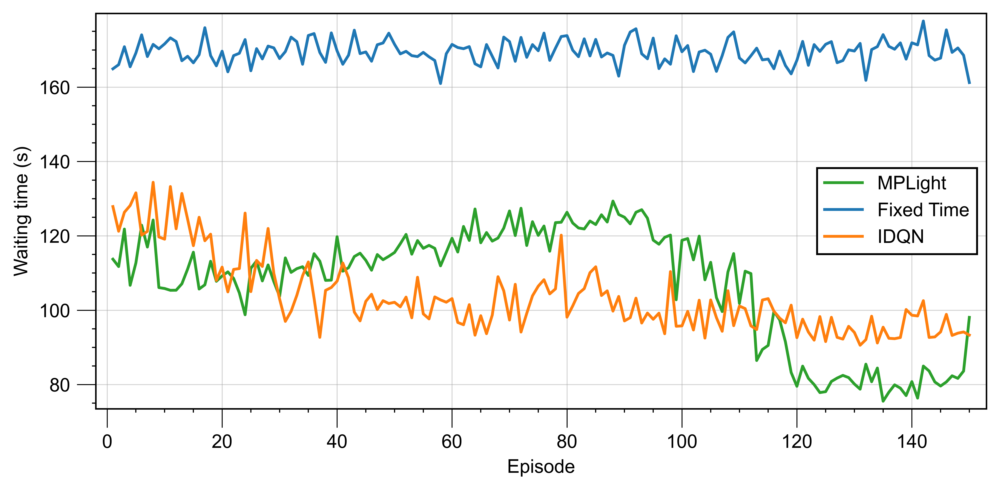

# Traffic Signal Control Optimization at the Tigerpass Intersection for Heterogeneous Traffic Using Reinforcement Learning

# Methodology

# Result

<table>
  <tr>
    <td align="center">
       
      <em>Phase length vs Episode</em>
    </td>
    <td align="center">
       
      <em>Queue length vs Episode</em>
    </td>
  </tr>
</table>

<table>
  <tr>
    <td align="center">
       
      <em>Delay vs Episode</em>
    </td>
    <td align="center">
       
      <em>Waiting time vs Episode</em>
    </td>
  </tr>
</table>
